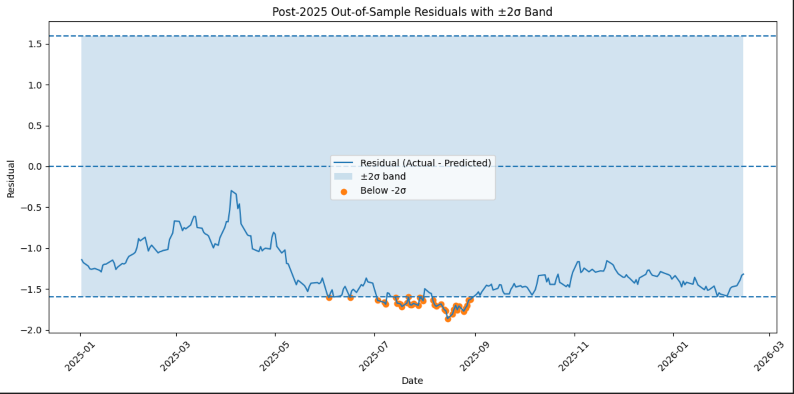
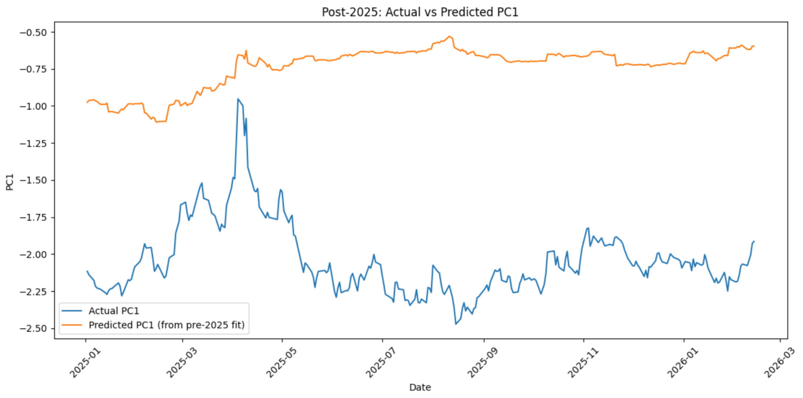
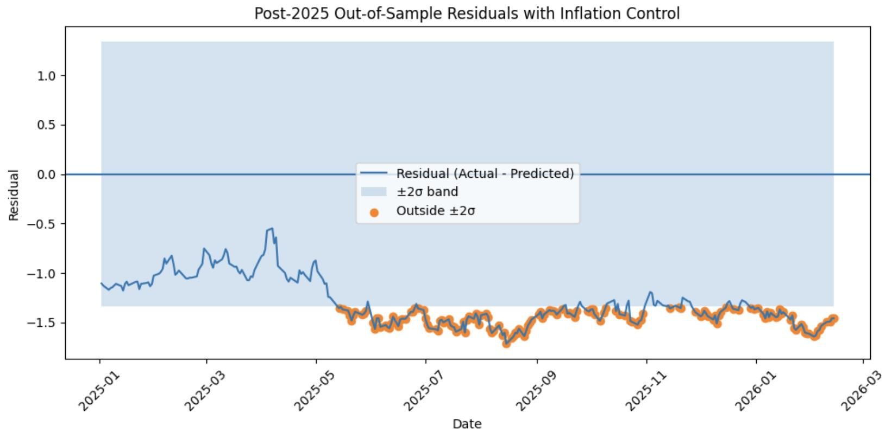
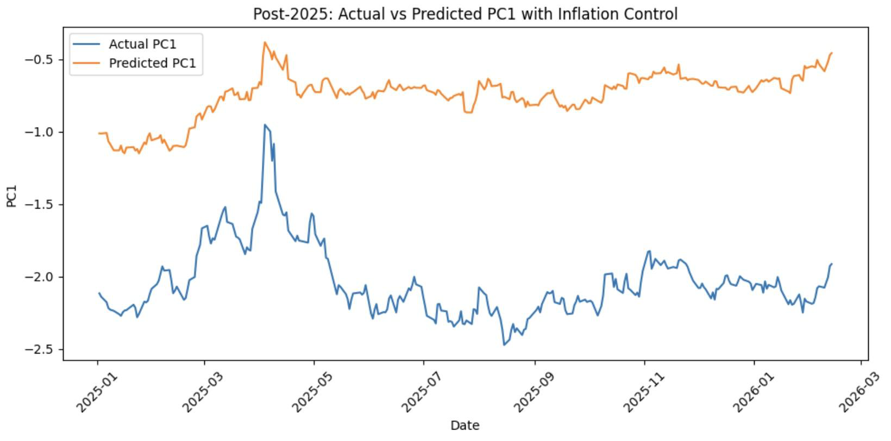

# Quantitative Evidence of Safe-Haven Erosion

While the diminished safe-haven status of Treasuries has been recognised in the last few months, along with the relationship between the convenience yield and stock-bond correlation, little has been said in regard to the relationship between the two. In particular, the literature is characterized by an absence of commentary on the fair valuation of the convenience yield vis-a-vis the stock-bond correlation. Related work shows that increases in perceived U.S. risk compress the convenience yield, and that the long-maturity Treasury premium has trended lower in the post-crisis era (Corsetti et al.; Du et al.). But neither groups of research estimate a covariance-implied fair value for the convenience yield itself. That is, given a level of stock-bond correlation, what is the level of convenience yield suggested by the historical relationship of the two, and where is this level relative to prevailing estimates of the convenience yield? Finally, if the observed convenience yield is less than the model-implied fair value, this will constitute evidence that the safe-haven status of Treasuries has diminished. This investigation is an important step to quantitatively highlight the diminished safe-haven status through the means of analyzing the performance of the convenience yield with respect to the stock-bond correlation. Addressing this empirical gap helps clarify whether investors can still rely on Treasuries as a hedge against equity risk, which is extremely timely as markets navigate ongoing trade tensions and elevated stagnation risk (Gattiker et al.). In this environment, where traditional assumptions regarding portfolio construction are being tested, understanding whether the convenience yield has structurally deviated from its historical benchmark will quantitatively clarify and extend the existing qualitative research on whether Treasuries are still safe-haven assets to invest in during periods of market stress.

This paper will address this question: To what extent has the convenience yield of Treasuries underperformed its historical relationship with stock–bond correlation, as measured through a regression-based correlational analysis? The method the paper will use is quantitative regression-based correlational analysis, in which the convenience yield is regressed against the rolling 60-day stock-bond correlation to estimate a historical benchmark relationship, and deviations from that benchmark are then evaluated through regression residuals. It is hypothesized that this diminished safe-haven status of the Treasuries in 2025 can be reflected in the convenience yield underperforming its historical relationship with the stock-bond correlation.

## Methodology

Based on the current literature on this topic, if the convenience yield underperforms its historical relationship with stock–bond correlation, then this provides empirical evidence of a diminished safe-haven status of Treasuries.

### Quantitative Regression-Based Correlational Analysis

With these considerations in mind, it is important to break down and define the different components of the method. Quantitative analysis relies on observations backed by empirical evidence, and a “correlational analysis” is a method that measures the strength and direction of association between two variables (Baraka; Janse et al.). In the context of this study's inquiry, this refers to determining the relationship between the convenience yield and stock-bond correlation. The “regression” generates predicted values of the convenience yield for given levels of stock–bond correlation, using historical data to establish a benchmark relationship. This regression-based correlational approach is the most appropriate method for this study because it allows for the estimation of a historical benchmark relationship and the identification of systematic deviations from that benchmark, which descriptive statistics or qualitative approaches cannot rigorously measure. The method further builds on the structure of Acharya and Laarits (8), who decompose Treasury yields into their component parts, which include the convenience yield, and then correlate the change in convenience yield to stock-bond covariance to show that the erosion of the convenience yield relates to a loss of Treasuries' hedging property. This study extends beyond that by estimating a historical benchmark relationship and then analyzing deviations through regression residuals, which is an approach reaffirmed by Diercks and Asnani, who similarly treat regression residuals as economically meaningful diagnostics for Treasuries.

### Data and Sample Selection

The full study consists of daily observations of U.S. equity and Treasury market data. These data were selected to capture the relationship between equities and Treasuries, therefore reflecting the UST’s hedging role, which is central to theories of convenience yield (Acharya and Laarits 2). Daily observations are used to capture short-term fluctuations in market relationships that would be obscured in lower-frequency data. The same period from which data is collected spans from January of 2010 to March of 2026; this time frame was purposefully selected to allow the model to estimate a historical relationship across varied data that have experienced various macroeconomic conditions (Cenci 227; Mitton 529). This ensures the historical benchmark that is calculated will be representative of diverse conditions, such as the post-2008 financial crisis, the COVID-19 pandemic, and the tariff war in 2025.

### Data Sources and Processing

Treasury yields are obtained from the Federal Reserve Economic Data (FRED). Yields on AAA-rated investment-grade corporate bonds come from FRED, and maturity-matched interest rate swap rates are drawn from Refinitiv Datastream and Bloomberg. To capture asset market movements, SPDR S&P 500 ETF (SPY) prices and iShares 20+ Year Treasury Bond ETF (TLT) prices are used. All datasets are aligned by date (See Appendix B).

### Dependent Variable: Convenience Yield Construction

The dependent variable, the convenience yield, cannot be directly observed; it is estimated indirectly. Two spreads are first constructed as the difference between yields of matched maturities: (1) the yield spread between Treasuries and AAA-rated corporate bonds of matching maturity, and (2) the yield spread between Treasuries and maturity-matched swap rates (See Appendix C). These spreads isolate Treasury-specific safety and liquidity advantages. A Principal Component Analysis (PCA), a statistical technique that reduces multiple correlated variables into a smaller set of components that retain most of the information in the data (Groth et al. 542), is then performed on these two spread series. This approach is validated by Acharya and Laarits (6), who similarly infer the convenience yield through market-based spreads targeting Treasury-specific safety and liquidity benefits. Specifically, they construct a synthetic nominal yield that isolates the convenience yield as the difference between the observed yield and the model-implied rate. This supports the use of PCA and spread-based proxies as established methods for quantifying this unobservable variable. The first principal component, which captures their shared movement, is extracted and used as the proxy for the convenience yield (Variable 1). This PCA-derived convenience-yield series is also what provides the current, observed convenience yield for 2025. Because the same PCA factors are applied across the entire sample, the 2025 values of the series represent today’s actual convenience yield, which can then be directly compared to the model-implied ‘fair value’ from the regression to determine whether Treasuries are underperforming.

### Independent Variable: Stock–Bond Correlation

The independent variable is the rolling 60-day stock-bond correlation (Variable 2), which measures how closely stock and bond returns move together. It is calculated as the Pearson correlation coefficient between daily percentage returns of SPY and TLT over a moving 60-day window (Molenaar et al. 17). A low or negative correlation indicates strong safe-haven behavior by Treasuries, while a rising correlation suggests a weakening of that status.

### Control Variable: Inflation Expectations

Furthermore, an additional control variable is included to account for inflation expectations, measured using the 5y5y TIPS breakeven rate (See Appendix D). This variable was identified by Acharya and Laarits (18) as an important factor that influences the convenience yield and its relationship with stock–bond correlation, particularly through its effect on the hedging properties of Treasuries, and its inclusion in this study was further supported following feedback from Matthias Gnewuch, an Economist at the European Stability Mechanism (See Appendix E). In essence, this is important, as it accounts for inflation-related effects on bond yields, allowing the model to get a more accurate estimate of the convenience yield.

### Regression Model Specification

To estimate this relationship, the following regression model is specified:

<em>Convenience Yieldt = α + β1 × Stock-Bond Correlationt + β2 · πt + εt</em>

Here, πt represents the 5-year/5-year forward inflation expectation rate, included as a control variable to account for inflation-driven variation in the convenience yield. εt represents the residuals, or in other words, the differences between the observed and predicted convenience yield given the stock-bond correlation. To determine whether Treasuries have recently underperformed their historical pattern, the rolling 520-day proportion of residuals exceeding one standard deviation is calculated. The 520-day window (approximately two trading years) was selected to capture a sufficiently long rolling horizon to differentiate persistent structural deviations from short-term noise, while also remaining sensitive enough to detect regime shifts within the 2025 out-of-sample period. This proportion measures how frequently the convenience yield significantly deviates from expectations. Negative residuals imply periods of underperformance, while positive residuals imply outperformance. While the model tracks deviations in both directions, this study's hypothesis specifically concerns negative residuals, as the claim is that safe-haven status has eroded, not strengthened.

## Results and Discussion

The hypothesis that the convenience yield would underperform its historical relationship with stock-bond correlation in late 2025 is supported by the following findings. More specifically, these findings provide direct empirical evidence for the hypothesis that the diminished safe-haven status of U.S. Treasuries in 2025 would be reflected in a statistically significant underperformance of the convenience yield relative to its historical benchmark.

### Baseline Regression Results

*Fig 1: Stock-Bond Correlation and Convenience Yields — 2025 Out-of-Sample Residuals*

*Fig 2: Out-of-Sample: Actual vs Predicted PC1*

The regression analysis reveals a clear deviation in the relationship between the convenience yield and its historical determinants (Figure 2). While prior literature explains both the behaviour of the convenience yield through hedging demand and inflation expectations and the appearance of a diminished safe-haven status, it doesn’t account for potential breakdowns of these relationships over time, thereby lacking a true quantitative measurement proving this diminished safe-haven status of the U.S. Treasuries. Using a baseline model with the 60-day rolling stock-bond correlation as the sole independent variable, the model explains approximately 50 percent of the variation in the convenience yield (R2 = 0.499; see Appendix G). This moderately strong relationship between Treasury hedging value and the convenience yield movements corroborates the relationship identified by Acharya and Laarits (4), who identified stock-bond covariance as a driver of the convenience yield; therefore, under normal conditions, Treasury hedging value reliably predicts the convenience yield (Acharya and Laarits 16). These results extend the literature by illustrating that the relationship between the convenience yield and stock-bond correlation can break down under periods of elevated macroeconomic stress.

### Out-of-Sample Underperformance (2025)

Furthermore, when examining the out-of-sample period between May 2025 and September 2025, the actual convenience yield falls below predicted values by more than two standard errors of the regression, representing a statistically significant negative deviation (See Appendix H). This finding directly answers the research question. The convenience yield systematically underperformed its model-implied fair value during this period, constituting empirical evidence of a structural break in Treasuries’ safe-haven status and not just a temporary fluctuation. Additionally, the orange dots in Figure 1 represent statistically significant residuals outside the 2-standard-deviation range during this period. The negative residuals between this specific period likely coincide with the lingering effects of the April 2025 tariff war escalation and a period of intensified investor concern about the U.S. fiscal outlook (Gattiker et al.). Specifically, the tariff shocks introduced stagflation risk by raising costs while slowing economic growth, which weakened the negative stock–bond correlation and reduced Treasuries’ effectiveness as a hedge, thereby lowering the convenience yield (Acharya and Laarits 5). Simultaneously, rising fiscal concerns increase Treasury supply and perceived risk, reducing their scarcity and safe-haven premium, which further compresses the convenience yield (Bensaidan; Thiagarajan). Therefore, this indicates that the periods of significant deviation seen in the results are in alignment with the current literature's qualitative assessments of when geopolitical tensions and macroeconomic events influenced the safe-haven status of the Treasury.

### Extended Model with Inflation Expectations

To further test this convenience yield breakdown, the model is extended to include the 5y5y TIPS breakeven inflation rate as an additional explanatory variable, which increases explanatory power to approximately 65% (R2 = 0.648; see Appendix I). This suggests that inflation expectations, as well as hedging demand, play a strong role in determining the convenience yield. Essentially, by incorporating inflation expectations alongside the hedging dynamics, the model more fully captures macroeconomic conditions influencing the convenience yield, serving as a better predictor of the convenience yield. This inclusion is further supported by Arcidiacono et al., who identify inflation expectations as a key determinant of bond yields and use them as a control variable to confirm that observed effects are not driven by broader economic conditions. In essence, the inclusion of inflation expectations represents a step toward a more complete coverage of the factors that explain the convenience yield.

### Persistence and Magnitude of Underperformance

*Fig 3: Stock-Bond Correlation, Inflation Expectation, and Convenience Yield — 2025 Out-of-Sample Residuals*

*Fig 4: 2025 Out-of-Sample: Actual vs Predicted PC1*

Moreover, the inclusion of inflation expectations amplifies the observed deviation in the 2025 out-of-sample period. In Figure 4, we see a similar underperformance pattern as in Figure 2 from the first test. However, the duration of statistically significant underperformance as seen in Figure 3 becomes longer compared to what’s seen in Figure 1, and the magnitude of the residuals increases. This is critical because it signifies that even after accounting for both hedging demand and inflation expectations, the observed convenience yield remains persistently lower than predicted values, thereby suggesting that additional factors may be influencing the Treasury pricing beyond the scope of the model. This has important implications, as it suggests that Treasuries may no longer provide the same level of portfolio protection during periods of market stress, fundamentally changing their role in risk management and asset allocation strategies.

### Interpretation of Findings

Overall, the results provide a quantitative answer to the research question: the convenience yield exhibited persistent, statistically significant underperformance relative to its model-implied fair value, even after controlling for both hedging value and inflation expectations. This extends the current literature by providing statistical evidence that the convenience yield of U.S. Treasuries deviated meaningfully from its historical determinants in the 2025 out-of-sample period, suggesting a more structural shift rather than a temporary fluctuation.

### Role of Unobserved Risk Factors

Even after controlling for both stock-bond correlation (hedging value) and inflation expectations, the significant negative residuals indicate that investors are requiring a higher-than-expected yield to hold Treasuries, since their safe-haven elements have weakened. However, it should be noted that since the convenience yield is not a specific numeric value, it must be measured indirectly. In the context of this study, it was measured through a PCA-derived proxy. The residuals capture the net effect of all unmodelled forces rather than that of one driver, meaning that the analysis identifies the magnitude of the deviation but doesn’t pinpoint the precise cause.

### Structural Shift in Treasury Pricing

The persistence and statistical significance of the negative residuals here would indicate the presence of a structural risk premium that extends beyond what inflation expectations and hedging dynamics can explain on their own. With this, Treasuries are no longer fully valued for their safety characteristics, because they are increasingly assessed through a lens of risk, and so concerns about debt and politics reduce their attractiveness as a risk-free asset. This aligns with the findings of Acharya and Laarits (9), who found that the April 2025 tariff war created stagflation risk that weakened the hedging value of Treasuries, which triggered investors to rotate toward other safe-haven assets like gold. This is a precise macroeconomic situation in which a structural risk premium would emerge, one where Treasuries lose their insurance-like properties across both inflation and growth shocks. This then leaves investors without the negative stock-bond correlation they have historically relied on; they demand this premium to compensate for this loss of a hedge. Unlike inflation expectations or hedging demand, these broader macroeconomic and political risks are more difficult to quantify, but their effects are clearly illuminated in the persistent negative residuals.

## Conclusion

Based on the findings of this paper, which documents statistically significant underperformance of the convenience yield relative to its historical relationship with stock-bond correlation, it is evident that the U.S. Treasury's safe-haven role has eroded in 2025. The convenience yield, as it stands, represents the quantitative measure for the safe-haven status, and an identifying factor of this convenience yield is the ability for Treasuries to provide a strong hedge (negative stock-bond correlation) towards other assets like equities. Therefore, by quantitatively measuring how the convenience yield has deviated from its historical benchmark with said hedging value, this study provides empirical evidence of a structural weakening of the safe-haven status of U.S. Treasuries. This study adds to the literature by providing the quantitative analysis that prior qualitative assessments of Treasury safe-haven erosion were missing, and confirms that the convenience yield's relationship with stock-bond correlation is not stable under macroeconomic stress.

### Implications for Investors and Portfolio Theory

For institutional investors and risk managers, the most consequential implication concerns the validity of standard portfolio risk models. Value at risk models and mean-variance optimization layouts typically assume a negative stock and bond correlation. This is an assumption that has historically justified significant allocations to long Treasury bonds as a hedge against equity dips. However, as the results show a decline in the convenience yield, this assumption no longer holds. Additionally, considering the current political and economic state as of April 2026, this breakdown is occurring precisely during a period of market stress, when hedging is most needed. This means that institutional risk models built on historical correlation data are underestimating portfolio drawdown risk in these stress scenarios, which is a failure with direct consequences for capital adequacy and investor protection. Portfolio managers would therefore have to re-examine whether their hedging strategies, including the conventional 60/40 equities-to-fixed-income distribution, remain suitable and appropriate in a time where Treasuries’ safe-haven premium has permanently weakened.

### Implications for Policymakers

For policymakers, the most significant implication of these findings relates to fiscal sustainability. If the structural risk premium identified in this study continues to be demanded, the U.S. government faces a situation where borrowing costs remain elevated even as inflation stabilizes, which is a form of fiscal dominance in which market confidence, instead of monetary conditions, becomes the binding constraint on debt sustainability. This suggests that restoring the safe-haven status may require a credible commitment to fiscal consolidation and not just monetary policy that rebuilds investor confidence in the long-run reliability of the Treasury.

### Market Implications and Mean Reversion

From a market opportunity perspective, the increased risk premium also creates a potential mean reversion opportunity. A mean-reversion opportunity occurs when an asset is temporarily overvalued or undervalued relative to its typical level, and investors expect it to come back to its mean, which allows them to profit from that adjustment (Chen). If the deviation reflects temporary overpricing of risk rather than an actual permanent shift, compression of this premium would lead to declining yields and rising prices of USTs along the duration curve. However, the evidence from this study, most particularly the fact that the deviation persisted and deepened even after controlling for inflation expectations, is more consistent with an actual structural shift rather than one that is momentary, and investors therefore would weigh that interpretation in their decision with this strategy.

**Taimur**
